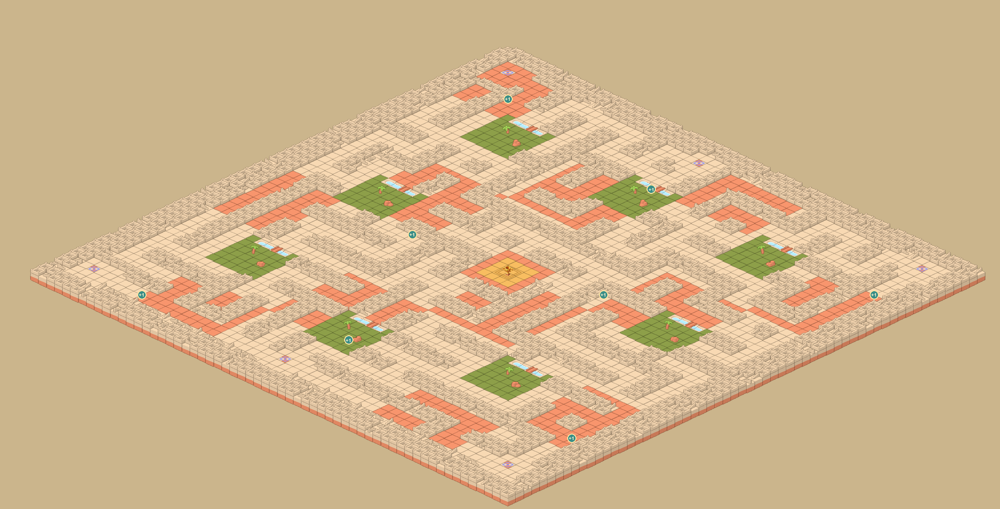

# Iso Game (PixiJS + Colyseus)

## Mapa del laberinto

El mapa actual mide 60 × 60 casillas y tiene pasillos de dos casillas, rutas alternativas,
seis zonas de aparición y una plaza central transitable de 6 × 6 casillas, despejada
para la futura copa. El suelo combina piedra lisa, tierra y hierba en ocho claros con
árboles y rocas aislados. Cada claro tiene un arroyo con un puente transitable.
La capa `grass` usa un tinte verde compatible con Tiled y el juego.
El juego usa las imágenes originales del tileset, con tinte verde para la hierba.
Todos los tiles de suelo se dibujan una sola vez y en el mismo orden isométrico,
para que sus laterales encajen sin superponerse ni parecer elevados.
Las marcas azules señalan únicamente las seis casillas de aparición; no hay escaleras.
Los muros, árboles, rocas y agua sin puente están marcados en la capa oculta `collision`.
La propiedad `spawnPositions` del mapa define las posiciones iniciales de los seis equipos.
`trophyPosition` coloca la copa en `[30, 30]`. El servidor declara ganador al primer
jugador que llega a esa casilla, también si la atraviesa durante un recorrido.
Al terminar se detiene el movimiento y todos ven el nombre del ganador.
«Jugar otra partida» conserva la sesión y entra en un nuevo lobby: los demás pueden
unirse pulsando el mismo botón. «Cerrar sesión» abandona la sala y borra el token de
la memoria del cliente. Cada nueva sala restaura la copa, las mejoras y el alcance inicial.
La imagen de la copa está en `client/public/assets/trophy.png`: se puede sustituir
por otro PNG transparente. El prompt de generación está en `docs/trophy-prompt.txt`.
El centro tiene un borde de terracota, suelo dorado y un emblema que lo distingue de los claros.
Cada clic permite recorrer inicialmente tres casillas del camino real, contando los rodeos.
Hay ocho bolitas `+1` compartidas: seis a ocho pasos de cada punto de aparición
y dos más repartidas por el interior, separadas de las anteriores.
Se recogen al pasar por su casilla, desaparecen para todos y aumentan permanentemente
en uno el alcance del jugador durante esa partida. Las mejoras se acumulan.
El servidor controla tanto la recogida como el alcance; el HUD muestra el límite actual.
La propiedad `boostPositions` permite editar sus posiciones.
La cámara usa una escala de 0.6 para mostrar un área más cercana al jugador.

Pruebas de movimiento y recogidas: `cd server` y `node --test tests/gameplay.test.js`.
Prueba de victoria y revancha con dos clientes WebSocket: `node --test tests/round-network.test.js`
(requiere también las dependencias de `client`).



Para editarlo en Tiled, abre `client/public/assets/map.tmx` y exporta a
`client/public/assets/map.tmj`, conservando las capas, propiedades y la referencia
`map_tiles.tsx`. Reinicia el servidor y recarga los clientes después de cambiarlo.

Para reconstruir el diseño original de este laberinto: `python scripts/generate_maze.py`.
Este comando sobrescribe ambos mapas; no lo ejecutes si quieres conservar ediciones manuales.

## Màquina virtual

- **Usuari:** *multi*
- **Contrasenya:** *patata1234*

## Engegar servidor i client

### Servidor (port 2567)

1. `cd server`
2. `cp .env.example .env` (només el primer cop)
3. `npm start` (o `npm run dev` per reiniciar automàticament en canviar fitxers)

#### Crear base de dades

Nomes cal executar `npm run db`.

### Client (port 5173)

1. `cd client`
2. `npm run dev`

## Crear mapes isometrics

Fet amb el programa [Tiled](https://thorbjorn.itch.io/tiled). El projecte del mapa esta a `client/public/assets/map.tmx`.

La capa principal es diu `ground` i despres hi ha la capa `collision` que determina les caselles que tindran col·lisions i que per tant el jugador no podra passar.

> La capa de col·lisions s'ha d'anomenar `collision`, si no tambe s'hauria de canviar en el codi.

## Actualitzar el mapa del joc

Hi ha 2 passos importants a fer:

1. Exportar el mapa **(File > Export > JSON map files (\*.tmj, \*.json))** a `client/public/assets/map.tmj`.
2. Obrir el fitxer exportat (`client/public/assets/map.tmj`) i canviar el parametre `source` del que hi hagi a **"map_tiles.tsx"**.

L'aparta de **tilesets** hauria de quedar aixi:

```json
...
"tilesets":[
    {
        "firstgid":1,
        "source":"map_tiles.tsx"
    }
],
...
```

## Docker (local)

Cal tenir Docker amb Compose.

```bash
docker compose up --build
```

- Client: http://localhost:8080
- Servidor: http://localhost:2567
- SQLite i avatars: volum `iso-data`, muntat a `/data` del servidor

## Desplegar a Render

`render.yaml` defineix dos serveis web (client i servidor) i un disc persistent d'1 GB pel servidor. Tots dos estan a `region: frankfurt`; canvia-ho abans del primer desplegament si vols una altra regió.

1. Puja els canvis al repositori.
2. A Render, crea un **Blueprint** i selecciona la branca `mejoras-backend`.
3. Comprova que `https://<servidor>.onrender.com/healthz` respon correctament.
4. Quan fusionis a `main`, canvia el camp `branch` de `render.yaml` (o la configuració dels serveis a Render).

Variables principals del servidor: `JWT_SECRET` (la genera Render), `COOKIE_SECURE=production`, `DB_PATH=/data/data.db`, `UPLOAD_DIR=/data/uploads`. El blueprint connecta `CLIENT_ORIGIN` i `SERVER_URL` entre els dos serveis.

> El pla `free` del client s'atura per inactivitat. El servidor necessita el pla `starter` per poder tenir disc persistent.

## Problemes alhora d'executar

Si hi ha qualsevol problema el millor es eliminar la carpeta `node_modules` i el fitxer `package-lock.json`.