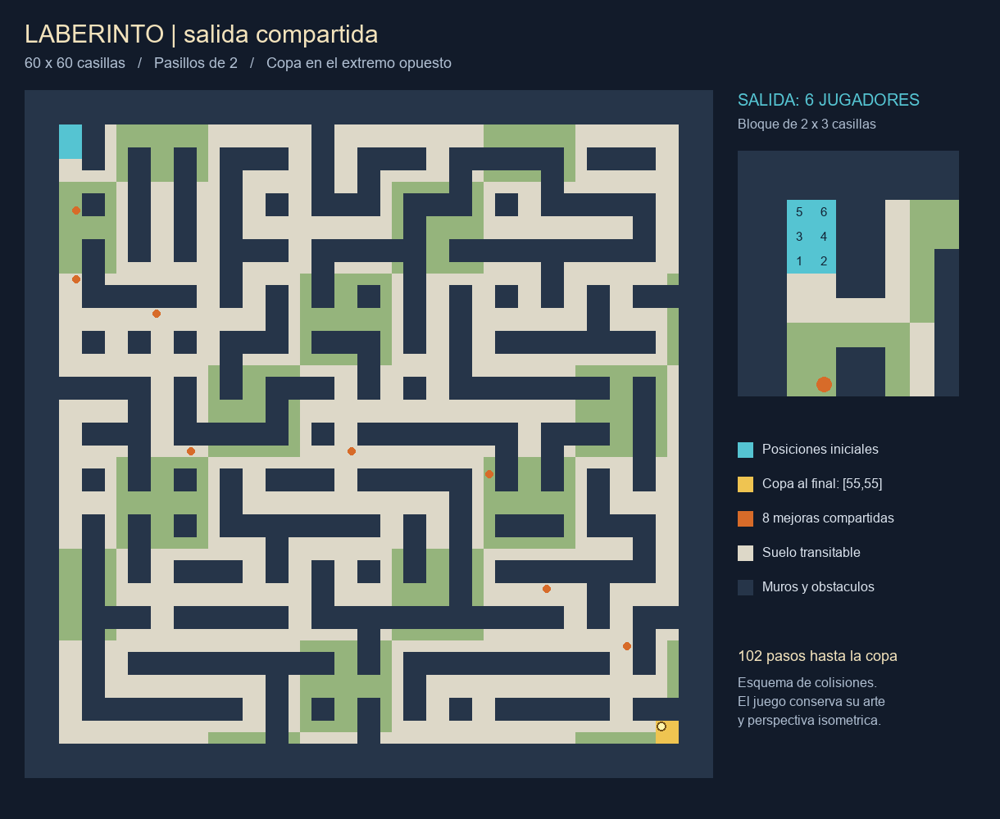

# Iso Game (PixiJS + Colyseus)

## Mapa del laberinto

El mapa mide 60 × 60 casillas. Todos los pasillos tienen dos casillas de ancho,
sin plazas, claros ni zonas de salida más anchas. Hay 79 cruces con tres o más
salidas y 42 conexiones alternativas para adelantar y cambiar de ruta. Árboles
y rocas decoran únicamente casillas bloqueadas.

Los seis jugadores salen del mismo lado, agrupados en un bloque de 2 × 3 casillas:
`[3,5]`, `[4,5]`, `[3,4]`, `[4,4]`, `[3,3]`, `[4,3]`. Comparten un acceso al
laberinto y los dos primeros pueden disputar la misma casilla desde su movimiento
inicial. Las marcas azules identifican esas seis posiciones.

La copa está en `[55,55]`, al final de un ramal con una única entrada de dos
casillas, en el extremo opuesto. El camino más corto desde la salida adelantada
mide 102 pasos (antes 204). El suelo dorado y el emblema acompañan la posición de la copa.
Las propiedades `spawnPositions`, `trophyPosition` y `boostPositions` del mapa
configuran las posiciones que utiliza el servidor.

Hay ocho mejoras `+1` compartidas a lo largo del recorrido, con las dos primeras
a 6 y 12 pasos de la salida adelantada. Se recogen al pasar por ellas, desaparecen
para todos y aumentan en uno el alcance del jugador durante esa partida, hasta
un máximo de 7 casillas por clic. Al llegar a 7, pasar por encima de otra bolita
no la recoge ni la elimina: queda disponible para otros jugadores. Se empieza
con un alcance de tres casillas por clic y el HUD muestra el alcance actual y el
máximo. El servidor controla movimiento,
colisiones, disputas, recogidas y victoria.

El primer jugador que llega a la copa gana, también si la atraviesa en un recorrido.
«Jugar otra partida» conserva la sesión y abre un lobby nuevo; los demás pueden
unirse con el mismo botón. Cada sala restaura copa, mejoras y alcance inicial.
La imagen de la copa está en `client/public/assets/trophy.png` y su prompt en
`docs/trophy-prompt.txt`. La cámara conserva una escala de 0.6.

Pruebas: `cd server` y `node --test tests/*.test.js` (las pruebas de red requieren
también las dependencias del cliente). Verifican conectividad, anchura de los
pasillos, salidas agrupadas, meta al fondo, disputas, recogidas y revancha.



Para editarlo en Tiled, abre `client/public/assets/map.tmx` y exporta a
`client/public/assets/map.tmj`, conservando las capas, propiedades y la referencia
`map_tiles.tsx`. Reinicia el servidor y recarga los clientes después de cambiarlo.

Para reconstruir el diseño original de este laberinto: `python scripts/generate_maze.py`.
Este comando sobrescribe ambos mapas; no lo ejecutes si quieres conservar ediciones manuales.
Para regenerar el esquema del README: `python scripts/preview_maze.py` (requiere Pillow).

## Màquina virtual

- **Usuari:** *multi*
- **Contrasenya:** *patata1234*

## Engegar servidor i client

### Servidor (port 2567)

Cal Node.js 22 o superior. En Windows PowerShell, si `npm` queda bloquejat
per la política de scripts, utilitza `npm.cmd` als comandos següents.

1. `cd server`
2. `npm install`
3. `npm start` (o `npm run dev` per reiniciar automàticament en canviar fitxers)

En local, l'arrencada crea `.env` a partir de `.env.example` si no existeix
i prepara les taules de SQLite automàticament, sense esborrar dades existents.
No cal entregar `.env`: està ignorat per Git. Si ja existeix, es conserva.
En producció cal configurar les variables i un `JWT_SECRET` propi;
la creació automàtica de `.env` només s'aplica a l'entorn local.

#### Crear base de dades

Opcionalment, es pot preparar per separat amb `npm run db`.

### Client (port 5173)

1. `cd client`
2. `npm install`
3. `npm run dev` (en una altra terminal, amb el servidor en marxa)

Obre http://localhost:5173 i inicia sessió. Per crear un compte, usa el botó
«Registrarse» (obre el formulari de la web del servidor a `/register`).

## Recuperación de contraseña con Brevo

El login del juego incluye «He olvidado mi contraseña», que abre la página
`/forgot` de la web del servidor. La recuperación se completa en `/forgot` y
`/reset`; ambas páginas usan `POST /api/forgot-password` y
`POST /api/reset-password` del backend. El enlace del correo apunta a
`SERVER_URL/reset`; en Render se usa automáticamente `RENDER_EXTERNAL_URL` si
`SERVER_URL` no está definida.

Configura estas variables **solo en el backend**, en `server/.env`:

```dotenv
BREVO_API_KEY=
BREVO_SENDER_EMAIL=
BREVO_SENDER_NAME="El torneo de los magos"
SERVER_URL=http://localhost:2567
TRUST_PROXY_HOPS=0
```

- Genera una **API Key**, no una clave SMTP, en Brevo: Settings → SMTP & API →
  API Keys & MCP. Documentación: https://help.brevo.com/hc/en-us/articles/209467485
- Añade y verifica el remitente que usarás en `BREVO_SENDER_EMAIL`, completa la
  autenticación de dominio que indique Brevo y comprueba que el envío transaccional
  esté activado. Guía: https://developers.brevo.com/docs/getting-started-with-senders-and-domains
- `SERVER_URL` es la URL pública de este servidor (no la del cliente). En
  producción es obligatoria: evita que un `Host` falso redirija el enlace de
  recuperación. Usa HTTPS en un despliegue público.
- No subas `.env`, no uses variables `VITE_` para estas credenciales y no las
  añadas al `/config.js` público. Reinicia el servidor después de configurarlas.
- El `.env` existente se conserva: añade estas variables manualmente si lo creaste
  antes de incorporar esta funcionalidad. No necesitas compartir la clave por chat.

En Render, el blueprint configura un salto de proxy; introduce la clave y el
remitente como variables del servicio **servidor**. Para un servicio ya creado,
comprueba también esas variables en su panel. `TRUST_PROXY_HOPS=0` sirve para
acceso directo local; usa `1` solo si el servidor está detrás de un único proxy de
confianza, como el despliegue previsto en Render. Una topología distinta requiere
revisar este valor para no aceptar IP falsificadas.

En Docker local puedes cargar las credenciales con
`docker compose --env-file server/.env up --build`.

### Comprobar el flujo

1. Arranca servidor y cliente y registra una cuenta con un correo que controles.
2. Pulsa «He olvidado mi contraseña» y envía ese correo.
3. Revisa la bandeja de entrada, spam y los registros transaccionales de Brevo.
4. Abre el enlace y elige una contraseña de al menos 12 caracteres. Inicia
   sesión con ella y comprueba que la anterior ya no funciona.
5. Reutiliza el enlace: debe fallar. Solicita dos enlaces separados por al menos
   un minuto: solo debe funcionar el último. A los 30 minutos caducan.
6. Un correo inexistente y un fallo del proveedor muestran la misma respuesta
   genérica. Los logs solo incluyen códigos seguros como `BREVO_HTTP_401`,
   `BREVO_HTTP_429`, `BREVO_NOT_CONFIGURED` o `RECOVERY_FAILED`.

Brevo recibe una petición HTTPS a `https://api.brevo.com/v3/smtp/email` con la
cabecera `api-key`. Una respuesta aceptada no garantiza entrega: compruébala en
su panel. No se envían correos reales en las pruebas automatizadas.

Los tokens tienen 32 bytes aleatorios; solo su SHA-256 se guarda en SQLite.
Registro, recuperación y cambio comparten `server/passwordPolicy.js`: mínimo 12 caracteres,
sin exigir mayúsculas, números ni símbolos, permitiendo frases y espacios. Se rechazan
contraseñas detectadas en Pwned Passwords enviando solo los cinco primeros caracteres
de su SHA-1. Si el servicio no responde, se permite continuar y se registra únicamente
`HIBP_UNAVAILABLE`, conservando el comportamiento original del registro.
Solicitar otro reemplaza el anterior. La contraseña se guarda con Argon2id y el
token se valida de nuevo y se consume dentro de la misma transacción del cambio.
Abrir el enlace no consume el token. Este viaja en el fragmento de URL y el cliente
lo retira de la barra al leerlo; recargar esa pantalla requiere abrir de nuevo el
enlace del correo. No se guarda en el almacenamiento del navegador.

Límites por proceso: 5 solicitudes por IP cada 15 minutos, 1 por correo cada minuto,
3 por correo cada hora y 10 intentos de cambio por IP cada 15 minutos. Los límites
por correo mantienen la respuesta genérica. Los contadores están en memoria y se
reinician al reiniciar el servidor; no se comparten entre varias instancias. El envío
en segundo plano evita esperar a Brevo para responder, pero no es una cola persistente:
si se detiene el proceso puede perderse el envío y habrá que solicitar otro enlace.
Los JWT de sesiones ya abiertas conservan su caducidad actual; esta función invalida
enlaces de recuperación, sin añadir revocación de sesiones al sistema existente.

Pruebas con SQLite en memoria y Brevo simulado:

```bash
cd server
node --test tests/password-recovery.test.js
```

## Crear mapes isometrics

Fet amb el programa [Tiled](https://thorbjorn.itch.io/tiled). El projecte del mapa esta a `client/public/assets/map.tmx`.

La capa principal es diu `ground` i despres hi ha la capa `collision` que determina les caselles que tindran col·lisions i que per tant el jugador no podra passar.

> La capa de col·lisions s'ha d'anomenar `collision`, si no tambe s'hauria de canviar en el codi.

## Actualitzar el mapa del joc

Hi ha 2 passos importants a fer:

1. Exportar el mapa **(File > Export > JSON map files (\*.tmj, \*.json))** a `client/public/assets/map.tmj`.
2. Obrir el fitxer exportat (`client/public/assets/map.tmj`) i canviar el parametre `source` del que hi hagi a **"map_tiles.tsx"**.

L'aparta de **tilesets** hauria de quedar aixi:

```json
...
"tilesets":[
    {
        "firstgid":1,
        "source":"map_tiles.tsx"
    }
],
...
```

## Docker (local)

Cal tenir Docker amb Compose.

```bash
docker compose up --build
```

- Client: http://localhost:8080
- Servidor: http://localhost:2567
- SQLite i avatars: volum `iso-data`, muntat a `/data` del servidor

## Desplegar a Render

`render.yaml` defineix dos serveis web (client i servidor) i un disc persistent d'1 GB pel servidor. Tots dos estan a `region: frankfurt`; canvia-ho abans del primer desplegament si vols una altra regió.

1. Puja els canvis al repositori.
2. A Render, crea un **Blueprint** i selecciona la branca `mejoras-backend`.
3. Comprova que `https://<servidor>.onrender.com/healthz` respon correctament.
4. Quan fusionis a `main`, canvia el camp `branch` de `render.yaml` (o la configuració dels serveis a Render).

Variables principals del servidor: `JWT_SECRET` (la genera Render), `COOKIE_SECURE=production`, `DB_PATH=/data/data.db`, `UPLOAD_DIR=/data/uploads`. El blueprint connecta `CLIENT_ORIGIN` i `SERVER_URL` entre els dos serveis.

> El pla `free` del client s'atura per inactivitat. El servidor necessita el pla `starter` per poder tenir disc persistent.

## Problemes alhora d'executar

Si hi ha qualsevol problema el millor es eliminar la carpeta `node_modules` i el fitxer `package-lock.json`.
